# Part 1 — Windows Server 2025 Fundamentals & Administration

## Objective

Prepare and understand a small Windows Server lab before deploying enterprise roles. This part covers the lab topology, virtual machine resources, basic IPv4 configuration, and connectivity verification.

> **Evidence boundary:** This README documents only the work visible in the supplied screenshots. Active Directory, DNS Server, DHCP, Group Policy, File Services and Print Services are future tasks and are not marked as completed here.

## Lab topology

| Machine | Current hostname in screenshots | Planned function | IPv4 address |
|---|---|---|---|
| Server 1 | `SERV-DC-01` | Domain Controller / DNS (planned) | `192.168.50.10` |
| Server 2 | `SERV-FS-01` | File / Print Server (planned) | `192.168.50.20` |
| Client | `Client01` | Windows 11 domain client (planned) | `192.168.50.30` |

### Network design

- Hypervisor: VMware Workstation Pro
- Virtual network: VMnet2
- Network mode: Host-only
- Subnet: `192.168.50.0/24`
- Subnet mask: `255.255.255.0`
- VMware DHCP: Disabled
- Default gateway: Blank (isolated lab)
- DNS client setting: `192.168.50.10` on all three systems

### VM resource allocation

| VM | RAM | vCPU | System disk |
|---|---:|---:|---:|
| SERVDC01 | 3 GB | 2 | 60 GB |
| SERVFS01 | 3 GB | 2 | 60 GB |
| Client01 | 4 GB | 2 | 80 GB |

## What we accomplished

1. Prepared three virtual machines for a multi-server Windows lab.
2. Connected the VMs to a dedicated Host-only virtual network.
3. Disabled VMware DHCP for the lab network.
4. Configured static IPv4 addresses on each machine.
5. Tested connectivity between the three machines using ping.
6. Confirmed successful replies in the supplied connectivity screenshots.

## Practical implementation and evidence

The screenshots below are embedded from the actual lab evidence. Each section explains what the screenshot demonstrates and why the configuration matters.

### 1. VMware virtual network

The lab uses VMware VMnet2 in Host-only mode to create an isolated network for the three machines. The intended subnet is 192.168.50.0/24. VMware DHCP is disabled because the machines are configured with static IPv4 addresses. The isolated network avoids depending on a physical LAN for internal lab communication.

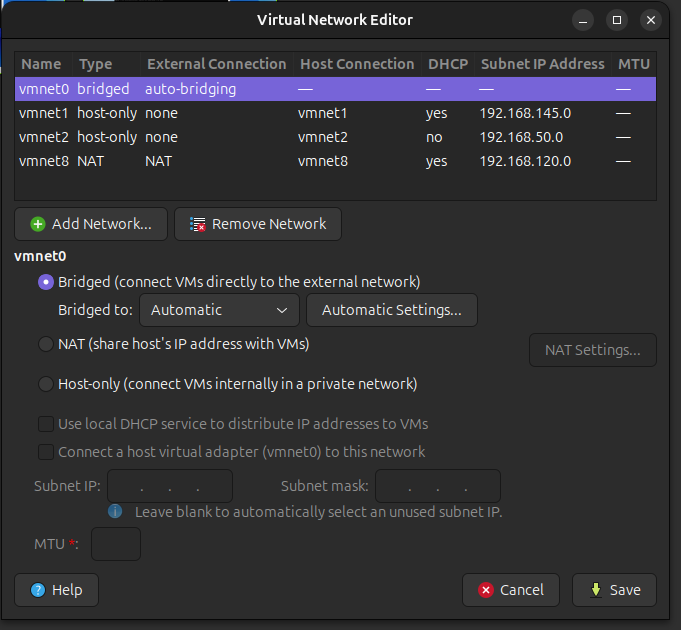

### 2. Virtual machine inventory

Three virtual machines were prepared: a Windows Server intended to become the domain controller, a second Windows Server intended for file and print services, and a Windows 11 client. This is a small multi-machine environment for practising common enterprise administration tasks.

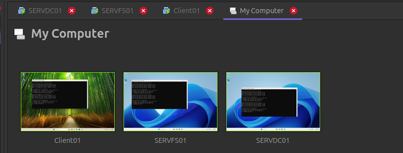

### 3. Domain controller VM resources

The server VM currently named SERVDC01 is allocated 3 GB RAM, 2 virtual CPUs and a 60 GB virtual disk in the supplied evidence. It is intended to host Active Directory Domain Services and DNS in a later part. Those roles are not yet installed or promoted.

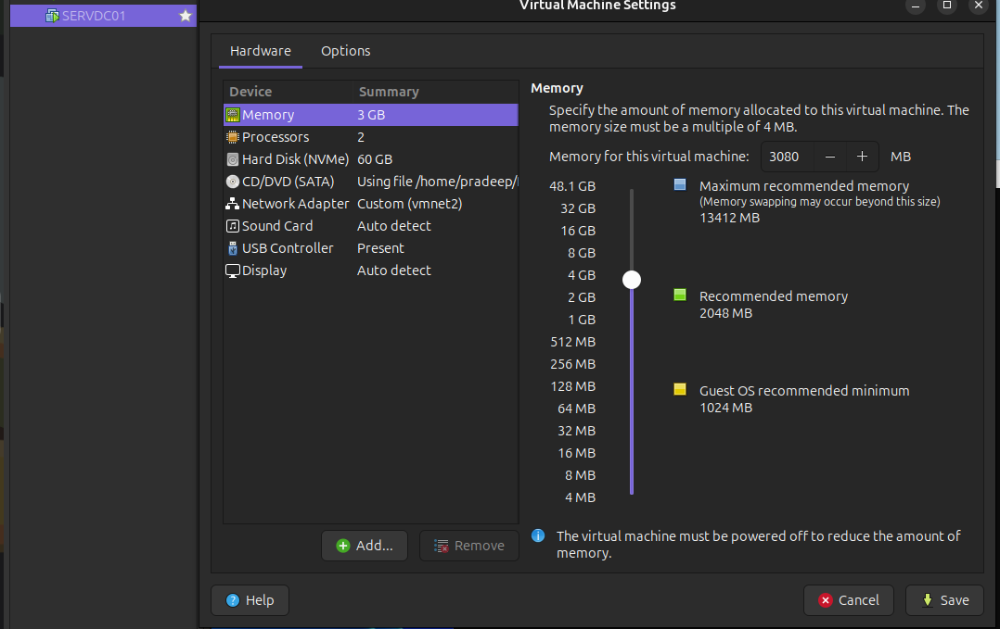

### 4. File server VM resources

The server VM currently named SERVFS01 is allocated 3 GB RAM, 2 virtual CPUs and a 60 GB virtual disk in the supplied evidence. A separate 20 GB data disk was part of the proposed design, but it is not visible in this screenshot and is therefore still a pending task.

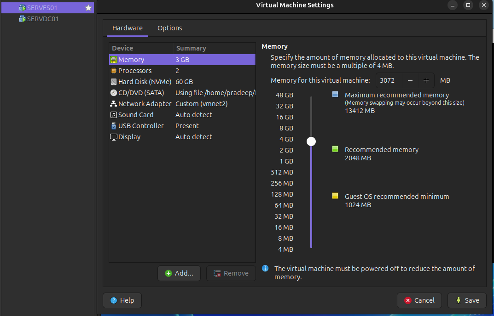

### 5. Windows client VM resources

The Windows 11 client VM is allocated 4 GB RAM, 2 virtual CPUs and an 80 GB virtual disk in the supplied evidence. It will later be used to test domain joining, Group Policy, user access and client-side troubleshooting.

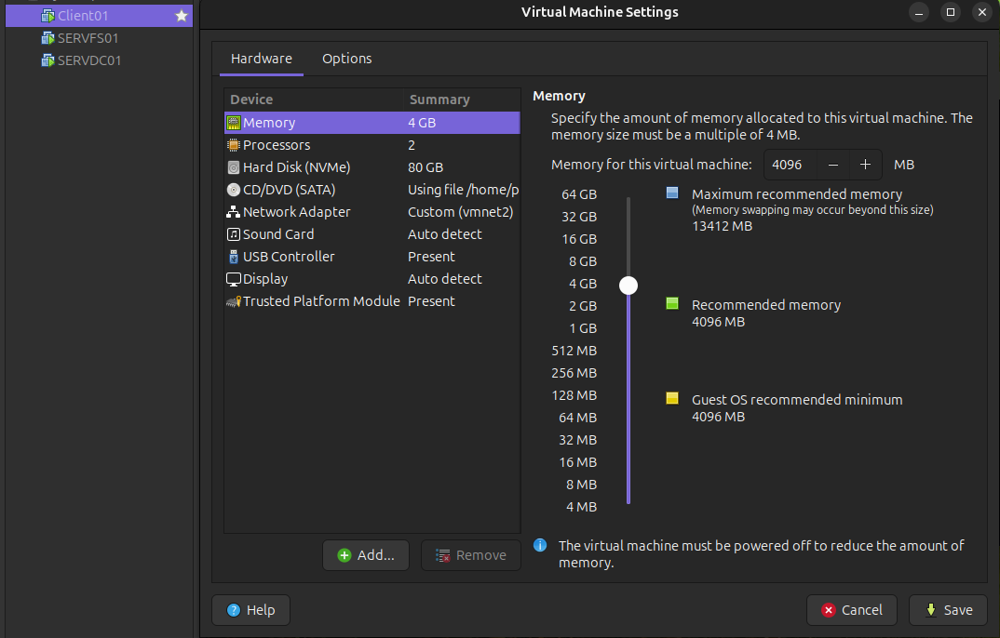

### 6. DC server IPv4 configuration

The server has the static address 192.168.50.10 with subnet mask 255.255.255.0. Its DNS client address is set to 192.168.50.10, reserving that address for the planned domain controller and DNS service.

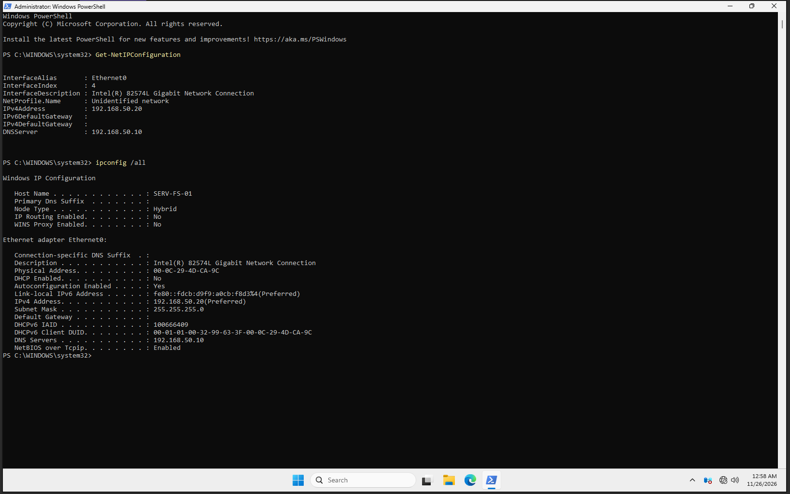

### 7. File server IPv4 configuration

The file server has the static address 192.168.50.20/24 and uses 192.168.50.10 as its DNS server. A static address makes server connectivity predictable and avoids the address changing unexpectedly.

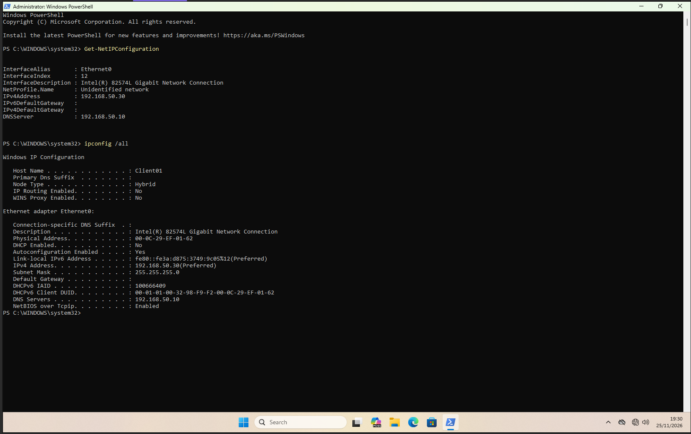

### 8. Client IPv4 configuration

The Windows client has the static address 192.168.50.30/24 and uses 192.168.50.10 as its DNS server. A default gateway is not configured because this Host-only lab is currently isolated and does not require routed internet access.

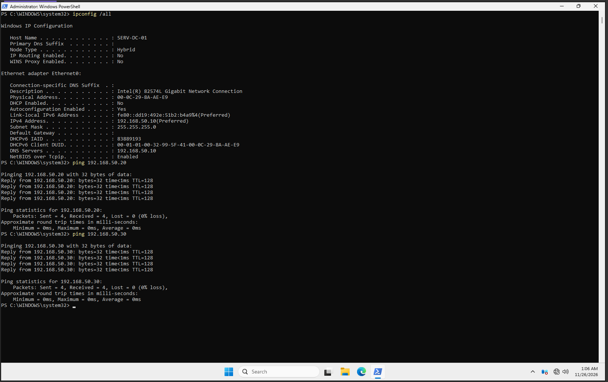

### 9. Connectivity verification: DC server

The DC server connectivity test shows successful ICMP replies to the other lab machines. This verifies basic IP reachability between the systems; it does not by itself prove that DNS, Active Directory or application services are working.

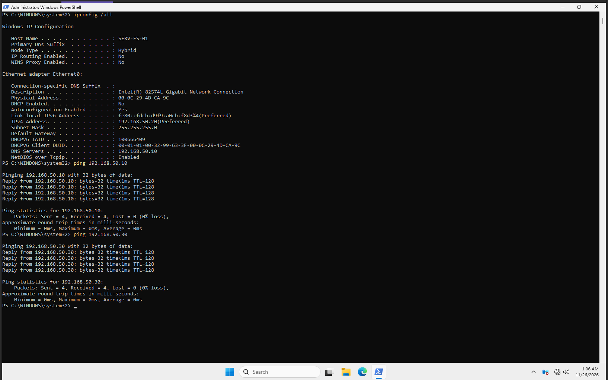

### 10. Connectivity verification: file server

The file server connectivity test shows successful communication with the other two machines. This helps isolate later problems: if ping continues to work but a file share fails, investigation can move to name resolution, SMB, permissions and firewall rules.

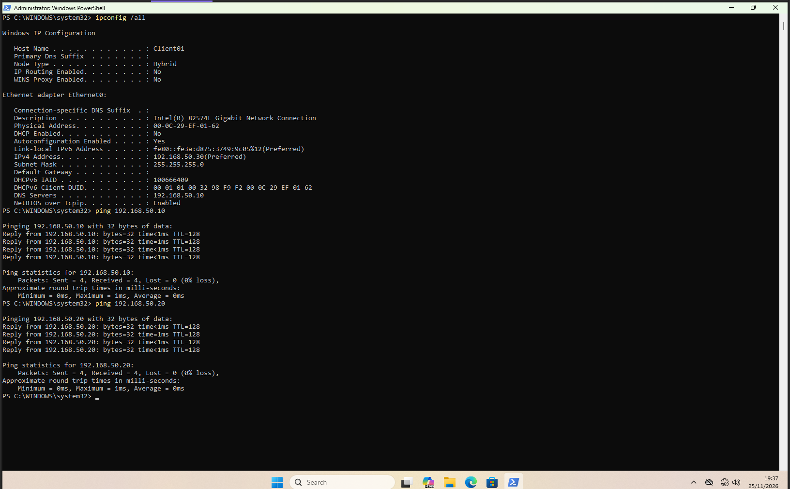

### 11. Connectivity verification: Windows client

The client connectivity test completes the three-way connectivity check. The supplied tests show successful replies and 0% packet loss for the displayed ping checks.

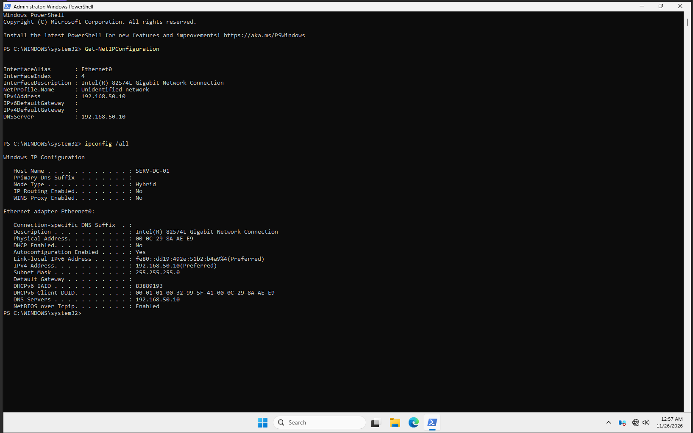

## Important administration concepts

### Why use a Host-only network?

A Host-only network allows the virtual machines and host to communicate on a private virtual network without automatically exposing the lab to the physical network. It is useful for safely practising server roles and client/server communication.

### Why assign static IP addresses to servers?

Infrastructure servers such as domain controllers, DNS servers and file servers should have predictable addresses. Other machines and services need to consistently locate them. Static addressing avoids unexpected changes caused by DHCP lease renewals.

### Why is the default gateway blank?

The current lab is an isolated Host-only network. A default gateway is only required when a machine needs to send traffic to networks outside its local subnet through a router. Internet access is not required for the connectivity tests shown here.

### What does a successful ping prove?

A successful ping confirms that ICMP Echo traffic can travel between the tested endpoints. It is a useful first network check, but it does not prove that DNS resolution, SMB file sharing, RDP, Active Directory or other application services are functioning.

### DNS readiness note

All three machines are configured to use `192.168.50.10` as DNS. However, the DNS Server role has not yet been evidenced as installed. The DNS client setting is preparation for the planned domain controller, not proof that DNS resolution is already available.

## L2 troubleshooting scenarios

| Symptom | Initial checks |
|---|---|
| Server cannot ping another VM | Check VM network adapter assignment, IP address, subnet mask, duplicate IPs and Windows Firewall ICMP rule. |
| Ping by IP works but hostname fails | Check DNS client settings, DNS server availability, DNS records and name resolution tools. |
| One VM is unreachable | Confirm the VM is powered on, connected to VMnet2 and using the expected subnet. |
| File share unavailable although ping works | Check SMB service, TCP 445 connectivity, firewall rules, share permissions and NTFS permissions. |
| Client cannot locate the domain | Verify DNS points to the domain controller and that AD DS/DNS are installed and healthy. |

## Interview questions

1. What is the difference between Host-only, NAT and Bridged networking in VMware?
2. Why should a domain controller normally use a static IP address?
3. What is the purpose of a subnet mask?
4. What is the role of a default gateway?
5. What does a successful ping test verify, and what does it not verify?
6. Why should domain-joined clients use the internal Active Directory DNS server?
7. How would you troubleshoot a server that can ping an IP address but cannot resolve its hostname?

## Current status

**Completed:** Initial VM preparation, static IPv4 configuration and basic inter-VM connectivity verification.

